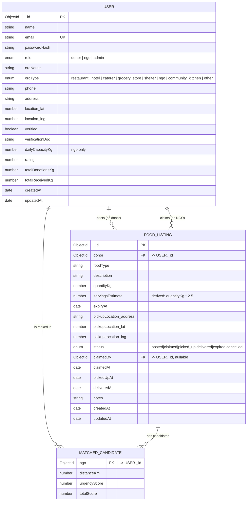
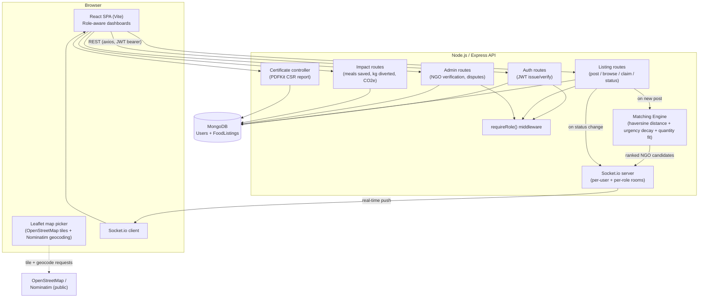

# FoodBridge — Design Document

## 1. Entity-Relationship Diagram

`MATCHED_CANDIDATE` is an embedded sub-document array inside `FOOD_LISTING`
(`matchedCandidates: [...]`) rather than a separate collection — it's a
denormalized snapshot of the matching engine's ranked output at post-time,
kept for transparency/audit ("why was this NGO notified?"), not a live
relation. It's modeled above as a distinct entity to make that ranking
relationship explicit.

**Design decisions:**
- MongoDB (document DB) was chosen over a strict relational schema because
  the two actor types (donor, NGO) share one `USER` collection distinguished
  by `role`, and `pickupLocation` / `location` are naturally nested objects.
  Both are still **normalized** for the relations that matter: `FOOD_LISTING`
  references `USER` by ObjectId (`donor`, `claimedBy`) rather than embedding
  donor/NGO data, avoiding duplication and stale copies.
- Compound indexes on `(status, expiryAt)` and `(lat, lng)` support the two
  hottest queries: "active listings sorted by urgency" and "listings near a
  point" (matching engine).

---

## 2. System Architecture

**Request flow — donor posts surplus food:**
1. Donor submits the listing form (React) → `POST /api/listings` (JWT-authed, `role: donor` only).
2. `listingController.create` saves the `FoodListing`, then calls the matching
   engine (`rankCandidates`) against all verified NGOs within
   `MAX_MATCH_RADIUS_KM`.
3. Ranked candidates are stored on the listing (`matchedCandidates`, for
   audit) and the top matches are emitted over Socket.io to
   `role:ngo` / targeted `user:<id>` rooms.
4. Matched NGOs' browsers receive the push instantly (no polling) and can
   claim the listing, which flips `status: posted → claimed` and notifies
   the donor the same way.
5. `picked_up → delivered` transitions are logged with timestamps, which
   feed directly into the impact calculator (meals saved, kg diverted).

---

## 3. Why these tech choices

| Layer | Choice | Reasoning |
|---|---|---|
| DB | MongoDB | Flexible schema for two actor types in one collection; fast to iterate on during a college project timeline |
| Real-time | Socket.io | Simpler than raw WebSockets for room-based targeting (per-user, per-role); auto-reconnect handled |
| Geolocation | Leaflet + OpenStreetMap + Nominatim | Free, no API key required — avoids Google Maps billing setup for a student/early-stage project |
| Auth | JWT + bcrypt | Stateless, easy to scale horizontally later; no session store needed |
| PDF | PDFKit | Generates the CSR donation certificate server-side, which is the platform's core monetization hook |
